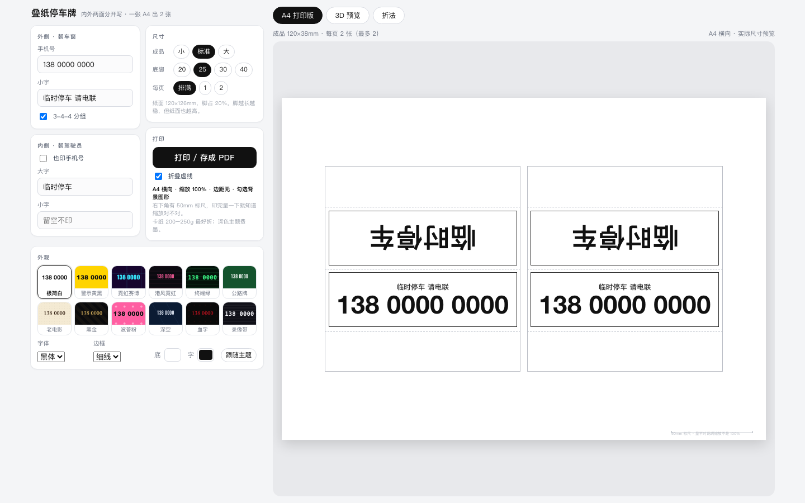
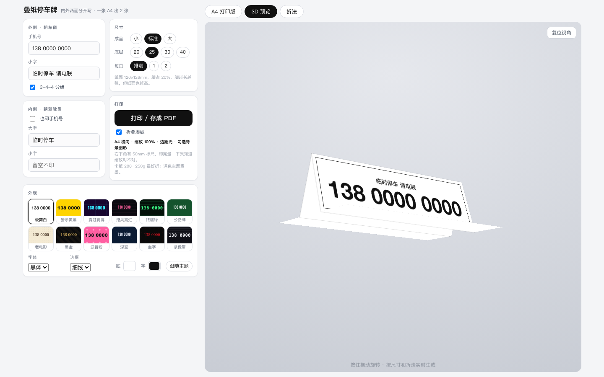
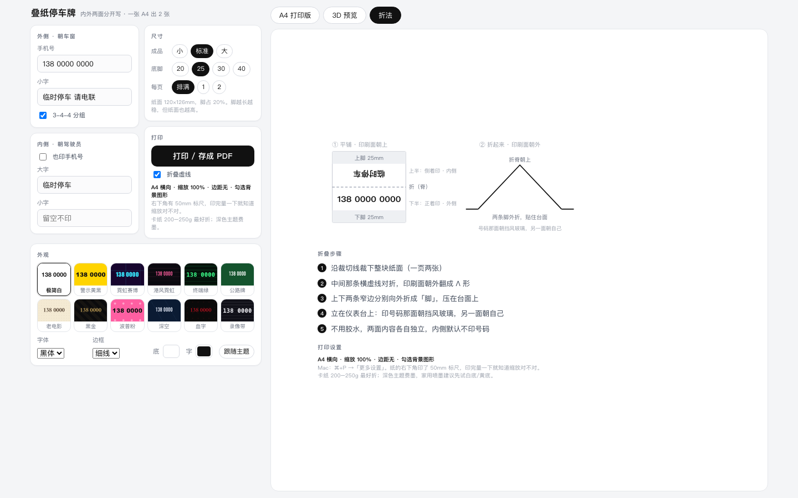
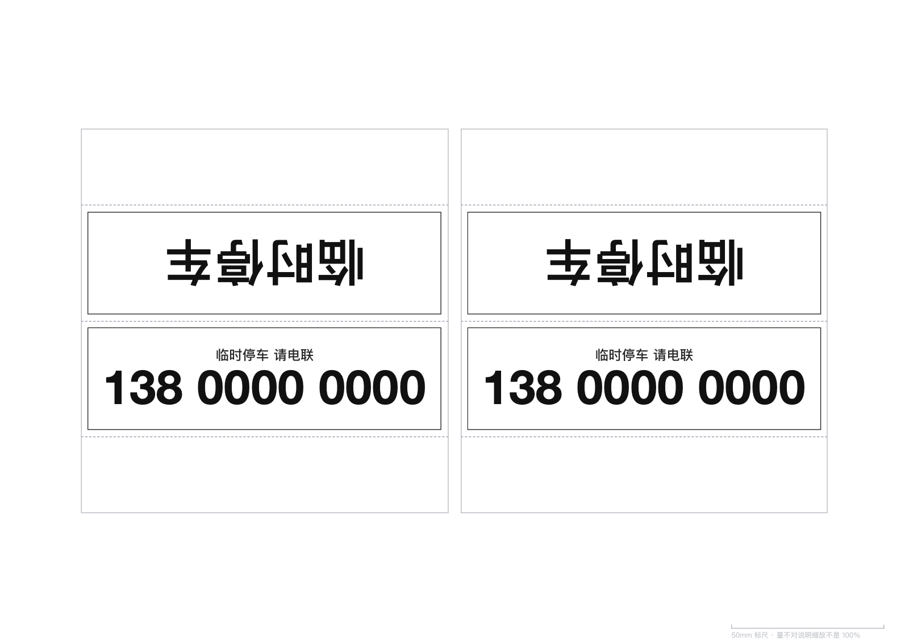

# 叠纸停车牌 Paper Parking Card

一张 A4 纸，填手机号 → 打印 → 裁 → 折，做成一个可以立在仪表台上的挪车号码牌。

**内外两面分开设置**：朝车窗那面印手机号，朝驾驶员那面默认不印号码（开车时用不着看自己的号）。



## 在线使用

**https://nefelibatai4.github.io/paper-parking-card/**

打开就能用，不需要安装任何东西。也可以直接把 `index.html` 存下来双击打开——没有外部依赖，断网也能跑。

## 特点

- **尺寸照着市售停车牌做**：面宽 120mm、高 38mm（市售款约 120–128 × 34–36mm），放仪表台上不占地方
- **一页两张**：A4 横向排两张，裁完就是两个成品
- **内外不同内容**：外侧印号码，内侧可以留白、写自己的字，也可以勾选同样印号码
- **12 套主题**：极简白、警示黄黑、霓虹赛博、港风霓虹、终端绿、公路牌、老电影、黑金、波普粉、深空、血字、录像带
- **字体 / 边框 / 颜色都能换**：黑体、超黑、车牌、海报、等宽、宋体、手写
- **实时 3D 预览**：拖动旋转，折起来是什么样先看再打
- **50mm 标尺**：印在纸角，印完拿尺子量一下就知道打印比例对不对

 

## 打印

| 设置 | 值 |
|---|---|
| 纸张 | A4 **横向** |
| 缩放 | **100%**（别选「适合页面」） |
| 边距 | 无 |
| 背景图形 | 勾选 |

Chrome / Edge / Safari 都可以，在打印对话框里选「另存为 PDF」就能拿到精确尺寸的 PDF。

纸质建议 **200–250g 卡纸**；普通 A4 也能做，建议内侧贴一层硬纸板。深色主题很费墨，家用喷墨先试白底或黄底。

打印出来长这样（A4 整页，两个成品）：



## 折叠

1. 沿裁切线裁下整块纸面
2. 中间那条横虚线对折，**印刷面朝外**翻成 Λ 形
3. 上下两条窄边分别向外折成「脚」，压在台面上
4. 立在仪表台上，印号码那面朝挡风玻璃

折叠线打在成品内侧，正面看不到。不用胶水。

> 平铺在纸上时，**上半张是倒着印的，这是故意的**——折起来之后两面才能正读。

## 自定义

日常使用直接在页面上改就行。

想改结构的话，`index.html` 顶部：

```js
// 成品尺寸（毫米）：单个面的宽高
const LAYOUTS = {
  tent: { sizes:{ s:{w:100,h:34}, m:{w:120,h:38}, l:{w:145,h:42} } }
};

// 主题：加一条就是一个新主题
const THEMES = [
  { id:'plain', name:'极简白', bg:'#ffffff', fg:'#111111',
    pattern:'none', font:'hei', border:'thin' },
  ...
];
```

- 字号自动缩放到「面能容纳的最大值」，改尺寸不用手调字号
- `pattern` 填任意 CSS `background-image`，图案是矢量，打印不会糊
- 点阵类图案要另外设 `patternSize`，比如 `'4mm 4mm'`

## 几个踩过的坑

**1. 折叠方向**：折线在中间、印刷面朝外时，两个面的「字头」都要朝向中间那条折线。也就是说平铺时上半张必须倒着印。做反了折起来两面全倒。

**2. 字体粗细**：macOS 的 PingFang SC 最粗只到 Semibold，`font-weight:800` 和 600 渲染一模一样。数字想够黑得用 Helvetica Neue Bold 或 Arial Black；车牌感用 `DIN Condensed`（家族名不要加 Bold 后缀）。

**3. 3D 里不能量字号**：`getBoundingClientRect()` 返回的是变换后的投影尺寸，在 3D 场景里量出来会偏小。要先在屏幕外一个不带变换的容器里排版量好，再把节点搬进 3D。

**4. 3D 缩放不能按纸面宽度估**：转动后投影范围由「宽度 + 深度」共同决定，Λ 折叠转到俯视时进深会完全展开。改成先应用旋转、量一次真实投影包围盒，再缩放并居中。

**5. 打印不能依赖屏幕布局**：一屏布局给 `html,body` 加了 `height:100%; overflow:hidden`，这个约束会漏进打印把纸裁掉；改成 `overflow:visible` 又会因为纸面比页框高 0.1px 多出一页空白。最后是打印前把纸克隆到一个独立容器里，彻底和屏幕布局解耦。

## 尺寸调研

市售停车牌的实际规格：

| 产品 | 尺寸 | 来源 |
|---|---|---|
| XWH / 希万辉 XWH-HMP-017 | 128 × 34.5 × 17 mm | [震坤行](https://www.zkh360.com.cn/item/AF0333123.html) |
| ShopKimo BY1272 | 120 × 36 × 17 mm | [ShopKimo](https://www.shopkimo.com/product/product&product_id=2351) |

所以成品按 **120 × 38mm** 做（高度多留 2mm 给折叠后的视觉比例）。

## 现成样例

`samples/` 里是几张已经排好版的 PDF（占位号码 `138 0000 0000`），想先试打可以直接用：

| 文件 | 内容 |
|---|---|
| `samples/plain.pdf` | 白底，内侧「临时停车」、外侧号码 |
| `samples/hazard.pdf` | 黄底黑斜纹，Arial Black |
| `samples/neon.pdf` | 深紫底青字，Impact |
| `samples/both-sides.pdf` | 双面都印号码的对照版 |

## 相关项目

- [ryanshi1103/print-ready-nameplate-generator](https://github.com/ryanshi1103/print-ready-nameplate-generator) —— A4 可折叠三角姓名牌生成器，几何思路很值得参考
- [oozzbb/car-qrcode-notify](https://github.com/oozzbb/car-qrcode-notify) —— 不想把手机号明着印出来的话，可以考虑扫码挪车
- [nbbk/movecar](https://github.com/nbbk/movecar)、[bg7iae/CarAlert](https://github.com/bg7iae/CarAlert) —— 同类扫码挪车通知

## License

[MIT](LICENSE)
